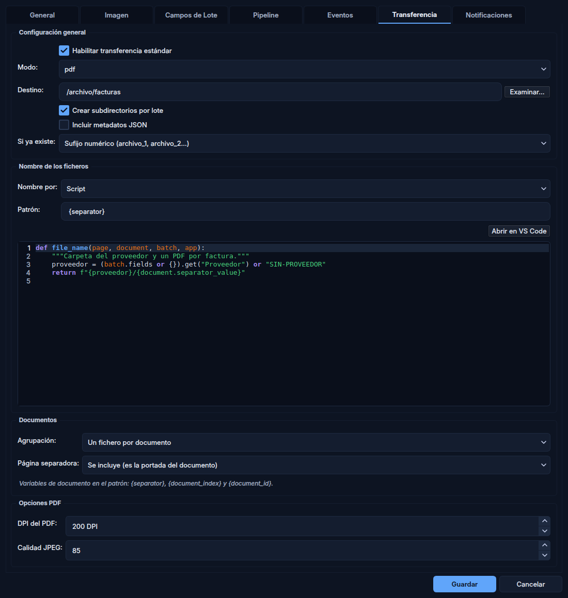
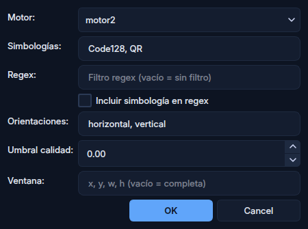

<p align="center">
  
</p>

<h1 align="center">📄 DocScan Studio</h1>

<p align="center">
  <strong>Captura, procesamiento e indexación de documentos por lotes, con IA generativa</strong>
</p>

<p align="center">
  <a href="README.md">English</a> · <strong>Español</strong>
</p>

<p align="center">
  <a href="https://github.com/ferreret/docscan/releases/latest"></a>
  
  
  
  
  
  
</p>

<p align="center">
  <a href="#-características">Características</a> •
  <a href="#-instalación">Instalación</a> •
  <a href="#-documentos-y-separadores">Documentos</a> •
  <a href="#-pipeline">Pipeline</a> •
  <a href="#-scripting">Scripting</a> •
  <a href="#-ai-mode">AI Mode</a> •
  <a href="https://ferreret.github.io/docscan/">Manual</a>
</p>

---

<p align="center">
  
  <br>
  <em>Workbench: un lote de facturas separado en documentos por su código de barras</em>
</p>

---

## 🎯 ¿Qué es DocScan Studio?

DocScan Studio es una aplicación de escritorio para **capturar documentos por lotes**
(escáner o importación), procesarlos (imagen, códigos de barras, OCR y scripts),
revisarlos e **indexarlos**, y transferirlos al archivo de destino.

Es un **entorno multi-aplicación**: el launcher reúne N *aplicaciones*, cada una un
perfil de proceso con su pipeline, sus campos, sus scripts y su transferencia
completamente independientes. Se agrupan por cliente o departamento.

DocScan es la **reimplementación multiplataforma** de FlexibarNET 10, un producto de
captura documental en .NET (solo Windows) que está en producción en hospitales.
Mantiene **paridad funcional** con él (la misma lógica, las mismas claves de
configuración y los mismos tokens), funciona en Linux y Windows, y añade IA
generativa para crear y configurar aplicaciones.

### Flujo de trabajo

```
📥 Escanear / importar → 🔄 Pipeline (imagen · barcode · OCR · scripts) → ✅ Revisar e indexar → 📤 Transferir
```

### Novedades de la v0.1.9

- **Inglés y catalán completos** en toda la interfaz.
- Los scripts reciben un cliente `http` (httpx), `on_key_event` se dispara y el
  límite de tiempo de los pasos Script se puede configurar.
- Se retira el Pipeline Assistant, que nunca llegó a la interfaz; la IA sigue en
  el AI Mode.

### Novedades de la v0.1.8

- **Separador de documento nativo**: el lote se divide en documentos por código de
  barras, de forma automática o manual (Ctrl+D), como en FlexibarNET 10.
- **Transferencia por documento**: un PDF, PDF/A o TIFF multipágina por documento,
  con el nombre por patrón o calculado por un script.
- **Configurador al estilo FlexibarNET 10**, con editor de scripts con colores, y
  **grupos** de aplicaciones en el launcher.
- Seis aplicaciones reales de FlexibarNET 10 (archivo del Hospital Arnau de
  Vilanova) portadas como prueba de aceptación.

Detalle en el [CHANGELOG](CHANGELOG.md).

---

## ✨ Características

<table>
<tr>
<td width="50%" valign="top">

### 🖨️ Captura
- Escaneo con **SANE** (Linux) y **TWAIN / WIA** (Windows)
- Importación de TIFF (multipágina), JPEG, PNG, BMP y PDF
- Alimentador automático y detección de páginas en blanco
- Worker desatendido que vigila una carpeta de entrada

</td>
<td width="50%" valign="top">

### 🔄 Pipeline composable
- Pasos de imagen, barcode, OCR y script, en el orden que se quiera
- 24 operaciones de imagen (enderezar, recortar, filtros…)
- Control de flujo desde script: saltar, repetir, abortar
- Prueba del pipeline sobre una imagen de muestra

</td>
</tr>
<tr>
<td valign="top">

### 🔍 Reconocimiento
- **Barcodes**: dos motores (pyzbar y zxing-cpp), hasta 15 simbologías
- **OCR**: RapidOCR, EasyOCR y Tesseract
- Lectura en toda la página o en una zona, con filtro por regex
- Alta manual de códigos con validación por regex

</td>
<td valign="top">

### 📑 Documentos e indexación
- Separador de documento por barcode, automático o manual
- Campos de lote (texto, fecha, número, booleano, lista)
- Campos de página y panel de verificación por script
- Revisión: páginas marcadas y navegación entre ellas

</td>
</tr>
<tr>
<td valign="top">

### 📤 Transferencia
- Carpeta, PDF, PDF/A, TIFF multipágina o CSV
- Un fichero por lote o por documento
- Nombre por patrón o por script; colisión: sufijo, sobrescribir o fusionar
- Todo se comprueba antes de escribir; nada queda a medias

</td>
<td valign="top">

### 🐍 Scripting Python
- 14 eventos del ciclo de vida y pasos Script en el pipeline
- Contexto completo: `app`, `batch`, `page`, `pipeline`
- Editor con colores y edición en VS Code
- Un fallo de script nunca cuenta como éxito

</td>
</tr>
<tr>
<td valign="top">

### 🤖 IA generativa
- **AI Mode**: crea y modifica aplicaciones conversando
- Cada cambio se enseña antes de aplicarlo: aceptar o rechazar
- Claude (Anthropic) u OpenAI, con claves cifradas con Fernet
- La IA configura; el proceso de cada página es determinista

</td>
<td valign="top">

### 🌐 Interfaz
- Español, inglés y catalán, completos
- Tema claro y oscuro
- Atajos de teclado de FlexibarNET 10
- Instaladores y actualización automática desde GitHub

</td>
</tr>
</table>

---

## 🚀 Instalación

### Con el instalador (recomendado)

Descarga la última versión desde [Releases](https://github.com/ferreret/docscan/releases/latest):

| Sistema | Fichero |
|---------|---------|
| Linux (x86_64) | `docscan-0.1.9-x86_64.AppImage` — darle permiso de ejecución y abrir |
| Windows | `docscan-0.1.9-setup.exe` — instalador |

`SHA256SUMS.txt` lleva las sumas de comprobación. La aplicación avisa cuando hay una
versión nueva y se actualiza sola. La base de datos se crea y se migra al arrancar.

### Desde el código

| Requisito | Versión | Notas |
|-----------|---------|-------|
| Python | **3.14** | Si el sistema no la trae, `uv` la instala |
| ZBar | — | Solo Linux, lo usa pyzbar (`libzbar0t64` en Ubuntu) |
| SANE | — | Solo Linux, para escanear (`libsane-dev`) |
| libxcb-cursor | — | Solo Linux, plataforma xcb de Qt (`libxcb-cursor0`) |
| Tesseract | 5.x | Opcional, OCR alternativo |

```bash
git clone https://github.com/ferreret/docscan.git
cd docscan
uv venv --python 3.14 --managed-python      # o bien: python3.14 -m venv .venv
uv pip install -r requirements.txt          # requirements-dev.txt añade tests y lint
.venv/bin/python main.py                    # Windows: .venv\Scripts\python.exe main.py
```

### Modos de ejecución

```bash
python main.py                                    # Launcher
python main.py "Facturas de proveedores"          # Abrir una aplicación directamente
python main.py --direct-mode "Facturas de proveedores"   # Escanear y transferir sin interfaz

# Worker desatendido
python -m docscan_worker --app-name "Facturas de proveedores" --watch /ruta/entrada
python -m docscan_worker --app-name "Facturas de proveedores" --process-pending
```

---

## 🖼️ Capturas

<table>
<tr>
<td width="50%"><br><sub>Launcher con las aplicaciones agrupadas</sub></td>
<td width="50%"><br><sub>Transferencia: un PDF por documento, nombre por script</sub></td>
</tr>
<tr>
<td><br><sub>Paso Barcode con la condición de separador</sub></td>
<td><br><sub>AI Mode: una aplicación creada conversando</sub></td>
</tr>
</table>

---

## 📑 Documentos y separadores

Un **documento** es el tramo de páginas que va de una página separadora a la
siguiente, como en FlexibarNET 10. El separador es una propiedad de la **página**
(`page.is_separator` y `page.separator_value`), no de un barcode. Las páginas
anteriores al primer separador forman un documento implícito.

El caso típico no necesita ningún script:

1. En el paso **Barcode** se activa *Separador de documento* con su condición. Por
   ejemplo, la regex `^(02|10)` evaluada sobre *NN + valor* marca como separadora
   toda página con un Code128 o un Interleaved 2 of 5 (los números de simbología
   son los de FlexibarNET). Al reprocesar, la detección manda sobre la marca manual.
2. En **Transferencia**: modo `pdf`, `pdfa` o `tiff`, *Un fichero por documento* y
   un patrón con `{separator}`, `{document_index}` o `{document_id}`. La página
   separadora puede ir dentro del documento (portada) o descartarse.
3. Con la colisión *Fusionar*, un documento cuyo nombre ya existe se añade al final
   del fichero: las páginas con el mismo código acaban juntas aunque lleguen en
   otro lote.

En el Workbench, **Ctrl+D** marca o desmarca la página como separadora (con su
valor, validado contra la regex manual del paso) y **Alt+↑ / Alt+↓** la mueven.

Si el nombre necesita lógica, lo calcula el **script de nombre**:

```python
def file_name(page, document, batch, app):
    from datetime import datetime

    fecha = datetime.strptime(batch.fields["Data"], "%d/%m/%Y")
    return f"{fecha:%Y%m%d}/{document.separator_value[-9:]}"  # sin extensión
```

Devolver `None` usa el patrón; si el script lanza una excepción, la transferencia no
se hace y no queda nada escrito. Las aplicaciones de archivo del Hospital Arnau de
Vilanova portadas de FlexibarNET 10 son un ejemplo completo
(`tools/arnau_apps.py`).

---

## 🔄 Pipeline

Cada página atraviesa una secuencia de pasos configurable por aplicación:

```
┌──────────┐   ┌──────────────┐   ┌──────────┐   ┌──────────┐
│ ImageOp  │──▶│   Barcode    │──▶│   OCR    │──▶│  Script  │
│ Deskew   │   │ Motor 1 / 2  │   │ RapidOCR │   │ Python   │
│ Recorte  │   │ + separador  │   │          │   │          │
└──────────┘   └──────────────┘   └──────────┘   └──────────┘
```

| Tipo | Descripción |
|------|-------------|
| `image_op` | Operación sobre la imagen (24 disponibles) |
| `barcode` | Lectura de códigos (2 motores, hasta 15 simbologías) y condición de separador |
| `ocr` | Reconocimiento de texto (3 motores) |
| `script` | Python con acceso al contexto completo |

<details>
<summary>📋 Las 24 operaciones de imagen</summary>

| Operación | Descripción |
|-----------|-------------|
| `AutoDeskew` | Corrección automática de la inclinación |
| `ConvertTo1Bpp` | Blanco y negro (1 bit) |
| `Crop` | Recorte rectangular |
| `CropWhiteBorders` / `CropBlackBorders` | Recorte automático de márgenes |
| `Resize` | Redimensionar |
| `Rotate` / `RotateAngle` | Rotar 90°/180°/270° o por ángulo |
| `SetBrightness` / `SetContrast` | Brillo y contraste |
| `RemoveLines` | Quitar líneas horizontales y verticales |
| `FxDespeckle` | Quitar ruido |
| `FxGrayscale` / `FxNegative` | Escala de grises / negativo |
| `FxDilate` / `FxErode` | Dilatación y erosión |
| `FxEqualizeIntensity` | Ecualización del histograma |
| `FloodFill` | Relleno por inundación |
| `RemoveHolePunch` | Quitar agujeros de perforadora |
| `SetResolution` | Fijar los DPI |
| `SwapColor` | Intercambiar colores |
| `KeepChannel` / `RemoveChannel` / `ScaleChannel` | Operaciones por canal de color |

</details>

<details>
<summary>📊 Simbologías de código de barras</summary>

| Simbología | Motor 1 (pyzbar) | Motor 2 (zxing-cpp) |
|------------|:-:|:-:|
| Code128, Code39, Code93, Codabar | ✅ | ✅ |
| EAN-13, EAN-8, UPC-A, UPC-E | ✅ | ✅ |
| ITF (Interleaved 2 of 5) | ✅ | ✅ |
| QR | ✅ | ✅ |
| PDF417, DataMatrix | — | ✅ |
| Aztec, MaxiCode, Micro QR | — | ✅ |

</details>

### Control de flujo desde script

```python
def mi_paso(app, batch, page, pipeline):
    if not page.barcodes:
        pipeline.repeat_step("codigos")      # como máximo 3 veces
    if not page.ocr_text and not page.barcodes:
        pipeline.abort("Página sin texto ni códigos")   # a revisión
    pipeline.skip_to("final")                # o skip_step("ocr")
    pipeline.set_metadata("tipo", "factura") # datos entre pasos de esta página
```

---

## 🐍 Scripting

| Objeto | Descripción | Disponible en |
|--------|-------------|---------------|
| `app` | Configuración de la aplicación | Todos |
| `batch` | Lote actual y sus campos | Todos |
| `page` | Página: imagen, `barcodes`, `ocr_text`, `fields`, separador | Pasos y eventos de página |
| `pipeline` | Control de flujo | Solo pasos Script |
| `log`, `http` | Logger del script y cliente httpx compartido | Todos |
| `re`, `json`, `datetime`, `Path`, `ImageLib` | Módulos estándar y utilidades de imagen | Todos |

**14 eventos** fuera del pipeline: `on_app_start`, `on_app_end`, `on_import`,
`on_scan_complete`, `on_batch_loaded`, `on_page_changed`, `on_transfer_validate`,
`on_transfer_advanced`, `on_transfer_page`, `on_navigate_prev`, `on_navigate_next`,
`on_navigate_script`, `on_key_event` e `init_global`. Las firmas están en la
[referencia de scripting](https://ferreret.github.io/docscan/reference/scripting-api/).

```python
# on_transfer_validate — devolver False o lanzar una excepción cancela la transferencia
def on_transfer_validate(app, batch, pages):
    sin_codigo = [p.page_index + 1 for p in pages if not p.is_separator]
    if sin_codigo:
        # ValueError = rechazo: el operador ve solo este mensaje
        raise ValueError(f"La página {sin_codigo[0]} no tiene código")
    return True
```

Los scripts se compilan una vez al cargar la aplicación y se pueden editar en VS Code
con autocompletado.

---

## 🤖 AI Mode

Asistente conversacional del launcher que **crea y modifica aplicaciones** en lenguaje
natural, mediante *tool calling*: crea, modifica, duplica o elimina aplicaciones
(pipeline, campos, transferencia) y escribe el código de sus eventos. Cada cambio
se enseña antes de aplicarlo, para aceptarlo o rechazarlo.

```
👤 Necesito una aplicación para facturas de proveedores: un PDF por factura,
   separado por el código Code128 de la primera página.

🤖 He creado «Facturas de proveedores»: enderezar → códigos de barras → OCR.
   El paso de códigos marca como separadora cada página con un Code128 que
   empieza por FAC-, y la transferencia genera un PDF por factura con el
   número como nombre. ¿Ajusto algo más?
```

---

## 📋 Configurador

| Pestaña | Contenido |
|---------|-----------|
| ⚙️ **General** | Nombre, descripción, grupo, color del icono, escáner, autotransferencia, páginas en blanco |
| 🖼️ **Imagen** | Formato de captura, modo de color, compresión |
| 📝 **Campos de lote** | Campos en maestro-detalle: tipo, obligatorio, descripción, valores |
| 🔄 **Pipeline** | Lista de pasos con su resumen; diálogo por tipo de paso |
| 📜 **Eventos** | Los 14 eventos y el panel de verificación en lista, con estado y casilla «Activado» |
| 📤 **Transferencia** | Modo, destino, colisión, nombre (patrón o script) y agrupación por documento |
| 🔔 **Notificaciones** | Webhook al terminar una transferencia o ante un error |

---

## ⌨️ Atajos de teclado

Los de captura son los de FlexibarNET 10. Los principales:

| Atajo | Acción |
|-------|--------|
| `F5` / `Ctrl+I` | Escanear / importar |
| `F9` / `Ctrl+P` | Procesar el lote / reprocesar la página |
| `Ctrl+T` / `Ctrl+W` | Transferir / cerrar el lote |
| `Ctrl+D` | Marcar o desmarcar separador de documento |
| `Alt+↑` / `Alt+↓` | Mover la página |
| `Ctrl+N` / `Insert` | Añadir un código a mano |
| `Ctrl+→` / `Ctrl+Shift+→` | Siguiente con barcode / pendiente de revisión |

La lista completa está en el [manual](https://ferreret.github.io/docscan/reference/shortcuts/).

---

## 🔒 Fiabilidad y seguridad

- **Nada falla en silencio**, como en FlexibarNET 10: un script que falla aparece en
  la página, en el log o como transferencia fallida, nunca como éxito.
- **La transferencia comprueba antes de escribir**: nombres, rutas e imágenes. Los
  ficheros multipágina se escriben de forma atómica.
- **Rutas blindadas**: un valor leído del papel no puede escribir fuera del destino.
- **Claves de API cifradas** con Fernet en `secrets.enc`, en el directorio de
  configuración del usuario.
- **SQLite en modo WAL** para que la interfaz y el worker trabajen a la vez; las
  migraciones se aplican solas al arrancar.
- **Límite de tiempo** configurable para los pasos Script del pipeline (30 s por defecto).

---

## 📁 Formatos

| Entrada | Salida |
|---------|--------|
| TIFF (también multipágina), JPEG, PNG, BMP, PDF | TIFF (LZW, ZIP, sin compresión o Group4 para B/N), JPEG, PNG, PDF, PDF/A-1b y 2b, CSV de índices |

En TIFF multipágina, Group4 solo se usa si todas las páginas son en blanco y negro;
si alguna es en gris o color, el fichero va en LZW (como FlexibarNET 10).

---

## 🏗️ Arquitectura

```
┌──────────────────────────────────────────────────────────────────┐
│  🏠 Launcher  │  ⚙️ Configurador  │  📋 Workbench  │  📂 Lotes     │
├──────────────────────────────────────────────────────────────────┤
│  Servicios: ScriptEngine · Barcode · ImagePipeline · OCR ·        │
│  Transfer (+ transfer_flow) · Batch · Import · Scanner · IA       │
├──────────────────────────────────────────────────────────────────┤
│  Pipeline: pasos → PipelineContext → executor → separador        │
├──────────────────────────────────────────────────────────────────┤
│  Persistencia: SQLAlchemy 2 · SQLite WAL · Alembic                │
└──────────────────────────────────────────────────────────────────┘
        ▲                                         ▲
   QThread workers (escaneo, reconocimiento,   docscan_worker
   transferencia): la interfaz nunca se bloquea  (desatendido)
```

```
docscan/
├── app/
│   ├── db/              # Motor, repositorios y migraciones al arrancar
│   ├── models/          # Modelos ORM y documento lógico
│   ├── pipeline/        # Pasos, contexto, executor, serializador, separador
│   ├── services/        # Barcode, OCR, imagen, transferencia, scripts, IA…
│   ├── ui/              # Launcher, Configurador, Workbench, gestor de lotes
│   └── workers/         # QThread de escaneo, reconocimiento y transferencia
├── docscan_worker/      # Worker desatendido (carpeta vigilada / pendientes)
├── config/              # Ajustes (pydantic) y secretos (Fernet)
├── alembic/             # Migraciones
├── resources/           # Iconos, estilos QSS, traducciones
├── tools/               # Capturas, Apps del Arnau, entrada de escritorio
├── docs-web/            # Manual (MkDocs)
└── tests/               # pytest + pytest-qt
```

---

## 🧪 Tests y calidad

```bash
QT_QPA_PLATFORM=offscreen .venv/bin/python -m pytest tests/ -q   # sin ventanas, ~35 s
.venv/bin/ruff check .
```

| Métrica (v0.1.9) | Valor |
|------------------|-------|
| Tests automáticos | **1226**, 0 fallos |
| Cobertura de líneas | **75 %** (`app/` + `docscan_worker/`) |
| Líneas de Python en `app/` | 26.172 |
| Líneas de tests | 18.375 |

La suite no necesita escáner ni pantalla y no toca la configuración del usuario.
Incluye pruebas de extremo a extremo por el worker real con códigos de barras reales.
El CI de GitHub Actions pasa lint y tests en cada push a `main` y en cada pull request.
Cómo se midió cada cifra:
[`docs/portfolio/metricas.md`](docs/portfolio/metricas.md).

---

## 📚 Documentación

- **[Manual de usuario](https://ferreret.github.io/docscan/)**: launcher,
  configurador, pipeline, workbench, transferencia y scripting.
- **[CHANGELOG](CHANGELOG.md)**: cambios de cada versión.
- **[Diseño del separador de documento](docs/diseno_separadores_documento_2026-10-26.md)**
  y **[propuestas desde FlexibarNET 10](docs/propuestas_desde_flexibarnet10_2026-10-26.md)**.

---

## 🗺️ Hoja de ruta

Hecho: pipeline composable, dos motores de barcode, tres de OCR, IA (AI Mode),
scripting, workbench, gestor de lotes, worker desatendido,
tres idiomas, instaladores con actualización automática, manual web, transferencia
que falla cerrada (lote 3) y separador de documento (lote 6).

Próximo:

- [ ] Familia eCAP del Hospital Arnau: secretos accesibles desde scripts y registro
      por ODBC.
- [ ] Lote 4: deshacer una transferencia que falla a medias.
- [ ] Lote 5: log a fichero con enmascarado de datos personales.
- [ ] Resto del lote 6: `{pagefield:}`, arrastrar miniaturas, cabeceras de documento.
- [ ] Validación con escáner físico en Linux.

---

## 🌐 Versión web (archivada)

El repositorio contiene una versión web multi-tenant (`web/`: API FastAPI, worker
ARQ, PostgreSQL, MinIO y Redis). **Está archivada desde julio de 2026** y no se
mantiene; sus tests se omiten solos si faltan sus dependencias.

---

## 👥 Créditos

Desarrollado por **Nicolás Barceló**.

<p align="center">
  <sub>DocScan Studio v0.1.9</sub>
</p>
