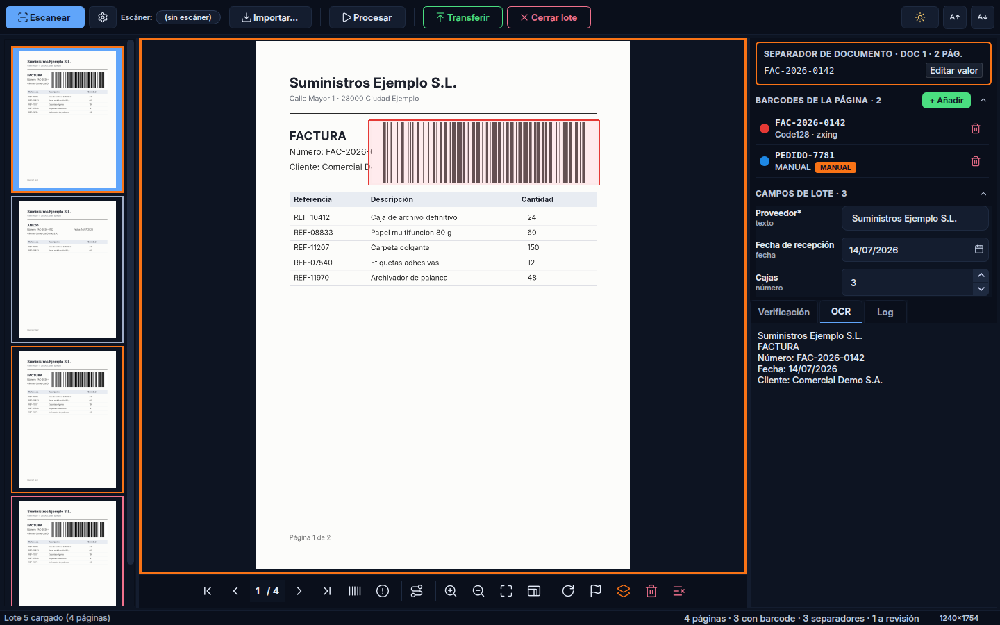

<p align="center">
  
</p>

<h1 align="center">📄 DocScan Studio</h1>

<p align="center">
  <strong>Plataforma de captura, procesamiento e indexación de documentos con IA generativa</strong>
</p>

<p align="center">
  
  
  
  
  
  
</p>

<p align="center">
  <a href="#-características">Características</a> •
  <a href="#-inicio-rápido">Inicio rápido</a> •
  <a href="#-arquitectura">Arquitectura</a> •
  <a href="#-pipeline">Pipeline</a> •
  <a href="#-scripting">Scripting</a> •
  <a href="#-ai-mode">AI Mode</a> •
  <a href="#-stack-tecnológico">Stack</a>
</p>

---

<p align="center">
  
</p>

---

## 🎯 ¿Qué es DocScan Studio?

DocScan Studio es una aplicación de escritorio **multi-aplicación** para la captura por lotes, procesamiento e indexación de documentos. Cada "aplicación" es un perfil de procesamiento completamente independiente con su propio pipeline, scripts, campos y configuración de transferencia.
En el launcher se pueden **agrupar** por cliente o departamento bajo cabeceras plegables, como en FlexibarNET 10.

> **Inspirado en Flexibar.NET** — reimaginado desde cero con Python, IA generativa y un pipeline completamente composable.

### Flujo de trabajo típico

```
📥 Escanear/Importar → 🔄 Pipeline (imagen + barcode + OCR + scripts) → ✅ Verificar → 📤 Transferir
```

---

## ✨ Características

<table>
<tr>
<td width="50%">

### 🖨️ Captura
- Escaneo directo via **SANE** (Linux) y **TWAIN/WIA** (Windows)
- Importación por arrastrar y soltar (TIFF, JPEG, PNG, PDF, BMP)
- Alimentador automático (ADF) con multi-página
- Detección automática de páginas en blanco

</td>
<td width="50%">

### 🔄 Pipeline composable
- 4 tipos de paso: imagen, barcode, OCR, script
- Orden libre y configurable por aplicación
- 23+ operaciones de imagen (deskew, crop, filtros...)
- Asistente IA para construir pipelines

</td>
</tr>
<tr>
<td>

### 🔍 Reconocimiento
- **Barcodes**: pyzbar + zxing-cpp (14 simbologías)
- **OCR**: RapidOCR, EasyOCR, Tesseract
- **IA**: Claude (Anthropic) y GPT-4o (OpenAI)
- Regiones configurables por coordenadas

</td>
<td>

### 📊 Indexación
- Campos de lote (texto, fecha, número, booleano, desplegable)
- Campos de documento/página con expresiones calculadas
- Separación de documentos por código de barras, automática o manual (Ctrl+D)
- Panel de verificación personalizable por script

</td>
</tr>
<tr>
<td>

### 🤖 AI Mode
- Asistente conversacional integrado en el Launcher
- Crea/modifica aplicaciones por lenguaje natural
- Pipeline Assistant para cada configuración
- Test pipeline sobre imagen de muestra

</td>
<td>

### 📤 Transferencia
- Exportación a carpeta (TIFF, JPEG, PNG, PDF, PDF/A, BMP)
- Transferencia avanzada por script Python
- Políticas de colisión: sufijo, sobreescribir, fusionar
- Fusión multi-página PDF/TIFF

</td>
</tr>
<tr>
<td>

### 🐍 Scripting Python
- Motor de scripts con contexto completo
- 7+ eventos del ciclo de vida
- Acceso a `app`, `batch`, `page`, `pipeline`
- Timeout configurable, errores no bloquean

</td>
<td>

### 🌐 Multi-idioma & Temas
- Español, English, Català
- Tema claro y oscuro
- Sidebar colapsable con iconos vectoriales
- Atajos de teclado configurables (17+)

</td>
</tr>
</table>

---

## 🚀 Inicio rápido

### Requisitos previos

| Requisito | Versión | Notas |
|-----------|---------|-------|
| Python | **3.14+** | Si el sistema no trae 3.14, `uv` la instala (ver abajo) |
| SQLite | 3.35+ | Incluido con Python |
| SANE | - | Solo Linux, para escaneo (`libsane-dev`) |
| ZBar | - | Solo Linux, lector de barcodes de pyzbar (`libzbar0t64` en Ubuntu) |
| libxcb-cursor | - | Solo Linux, plataforma xcb de Qt (`libxcb-cursor0`) |
| Tesseract | 5.x | Opcional, OCR fallback |

### Instalación

```bash
# 1. Clonar el repositorio
git clone https://github.com/ferreret/docscan.git
cd docscan

# 2. Crear entorno virtual
python3.14 -m venv .venv                  # o bien: uv venv --python 3.14 --managed-python
source .venv/bin/activate                 # Linux/macOS
# .venv\Scripts\activate                  # Windows

# 3. Instalar dependencias
pip install -r requirements.txt           # requirements-dev.txt añade tests y lint

# 4. ¡Lanzar! (la base de datos se crea y migra sola al arrancar)
python main.py
```

### Modos de ejecución

```bash
# 🏠 Launcher — gestionar aplicaciones
python main.py

# 🔧 Abrir directamente una aplicación
python main.py "Facturas Proveedores"

# 🤖 Modo headless — escanear y transferir sin UI
python main.py --direct-mode "Facturas Proveedores"

# ⚙️ Worker desatendido — vigilar una carpeta de entrada
python -m docscan_worker --app-name "Facturas Proveedores" --watch /ruta/entrada

# ⚙️ Worker desatendido — procesar lotes pendientes y salir
python -m docscan_worker --app-name "Facturas Proveedores" --process-pending
```

---

## 🌐 Versión web SaaS (archivada)

El repositorio contiene una versión web multi-tenant (`web/`, API FastAPI, worker ARQ,
PostgreSQL, MinIO y Redis con Docker Compose). **Está archivada desde julio de 2026** y
no se mantiene: el producto es la aplicación de escritorio. Sus tests se omiten solos
si faltan sus dependencias.

---

## 🏗️ Arquitectura

```
┌─────────────────────────────────────────────────────────────────┐
│                        DocScan Studio                           │
├─────────────┬──────────────┬──────────────┬─────────────────────┤
│  🏠 Launcher │ ⚙️ Configurador│ 📋 Workbench │ 📂 Batch Manager  │
├─────────────┴──────────────┴──────────────┴─────────────────────┤
│                        Servicios                                │
│  ScriptEngine │ BarcodeService │ ImagePipeline │ OcrService     │
│  TransferSvc  │ BatchService   │ ImportService │ ScannerService │
├─────────────────────────────────────────────────────────────────┤
│                     Pipeline Executor                           │
│         PipelineStep → Context → Flow Control → Results         │
├─────────────────────────────────────────────────────────────────┤
│                      Proveedores IA                             │
│              Anthropic │ OpenAI │ Local OCR                     │
├─────────────────────────────────────────────────────────────────┤
│                     Persistencia                                │
│           SQLAlchemy 2.x │ SQLite WAL │ Alembic                │
└─────────────────────────────────────────────────────────────────┘
```

### Estructura del proyecto

```
docscan/
├── app/
│   ├── db/              # Database, repositorios, modelos ORM
│   ├── models/          # Dataclasses y enums de dominio
│   ├── pipeline/        # Steps, Context, Executor, Serializer
│   ├── services/        # Lógica de negocio (barcode, OCR, imagen, transfer...)
│   ├── ui/
│   │   ├── launcher/    # Ventana principal, sidebar, AI Mode
│   │   ├── configurator/# 7 pestañas + diálogos de pasos
│   │   ├── workbench/   # Visor, miniaturas, paneles
│   │   └── batch_manager/# Historial de lotes
│   └── workers/         # QThread: scan, recognition, transfer
├── config/              # Settings (pydantic) + Secrets (Fernet)
├── resources/
│   ├── icons/           # SVG vectoriales
│   ├── styles/          # QSS temas claro/oscuro
│   └── translations/    # .ts para ES, EN, CAT
├── alembic/             # Migraciones de BD
├── tests/               # 939 tests (pytest + pytest-qt)
└── docs/                # Documentación e informes
```

### Métricas del código

| Métrica | Valor |
|---------|-------|
| Líneas de código (app) | **22.425** |
| Líneas de test (escritorio) | **14.459** |
| Ficheros fuente | **101** |
| Ficheros de test (escritorio) | **39** |
| Tests pasando | **939** ✅ |
| Ratio código:test | **1.6:1** |

---

## 🔄 Pipeline

El pipeline es el **corazón de DocScan Studio**. Cada página escaneada/importada atraviesa una secuencia configurable de pasos:

```
┌──────────┐   ┌──────────┐   ┌──────────┐   ┌──────────┐
│ ImageOp  │──▶│ Barcode  │──▶│   OCR    │──▶│  Script  │
│ AutoDesk │   │ Motor 1+2│   │ RapidOCR │   │ Separar  │
│ Crop     │   │ QR+C128  │   │          │   │ por BC   │
└──────────┘   └──────────┘   └──────────┘   └──────────┘
```

### Tipos de paso

| Tipo | Icono | Descripción |
|------|-------|-------------|
| `image_op` | 🖼️ | Operaciones sobre la imagen (23 disponibles) |
| `barcode` | 📊 | Lectura de códigos de barras (2 motores, 14 simbologías) |
| `ocr` | 📝 | Reconocimiento óptico de caracteres (3 motores) |
| `script` | 🐍 | Script Python con acceso al contexto completo |

### Operaciones de imagen disponibles

<details>
<summary>📋 Ver las 23 operaciones</summary>

| Operación | Descripción |
|-----------|-------------|
| `AutoDeskew` | Corrección automática de inclinación |
| `ConvertTo1Bpp` | Conversión a blanco y negro (1 bit) |
| `Crop` | Recorte rectangular |
| `CropWhiteBorders` | Recorte automático de márgenes blancos |
| `CropBlackBorders` | Recorte automático de márgenes negros |
| `Resize` | Redimensionar |
| `Rotate` | Rotar 90°, 180°, 270° |
| `RotateAngle` | Rotación libre por ángulo |
| `SetBrightness` | Ajustar brillo (-100 a +100) |
| `SetContrast` | Ajustar contraste (-100 a +100) |
| `RemoveLines` | Eliminar líneas horizontales/verticales |
| `FxDespeckle` | Eliminar ruido (speckle) |
| `FxGrayscale` | Convertir a escala de grises |
| `FxNegative` | Invertir colores |
| `FxDilate` | Dilatación morfológica |
| `FxErode` | Erosión morfológica |
| `FxEqualizeIntensity` | Ecualización de histograma |
| `FloodFill` | Relleno por inundación |
| `RemoveHolePunch` | Eliminar agujeros de perforadora |
| `SetResolution` | Ajustar DPI |
| `SwapColor` | Intercambiar colores |
| `KeepChannel` | Extraer canal de color (R/G/B) |
| `RemoveChannel` | Eliminar canal de color |

</details>

### Simbologías de barcode soportadas

<details>
<summary>📊 Ver simbologías</summary>

| Simbología | Motor 1 (pyzbar) | Motor 2 (zxing-cpp) |
|------------|:-:|:-:|
| Code128 | ✅ | ✅ |
| Code39 | ✅ | ✅ |
| Code93 | ✅ | ✅ |
| Codabar | ✅ | ✅ |
| EAN-13 | ✅ | ✅ |
| EAN-8 | ✅ | ✅ |
| UPC-A | ✅ | ✅ |
| UPC-E | ✅ | ✅ |
| ITF | ✅ | ✅ |
| QR Code | ✅ | ✅ |
| PDF417 | ✅ | ✅ |
| DataMatrix | ✅ | ✅ |
| Aztec | ❌ | ✅ |
| MaxiCode | ❌ | ✅ |
| MicroQR | ❌ | ✅ |

</details>

### Control de flujo en scripts

El `PipelineContext` permite que los scripts controlen la ejecución:

```python
def mi_script(app, batch, page, pipeline):
    # Saltar un paso
    pipeline.skip_step("paso_ocr_1")

    # Saltar hasta un paso específico
    pipeline.skip_to("paso_final")

    # Repetir el paso actual (máx. 3 veces)
    if not page.barcodes:
        pipeline.repeat_step("paso_barcode_1")

    # Reemplazar la imagen procesada
    import cv2
    gray = cv2.cvtColor(pipeline.current_image, cv2.COLOR_BGR2GRAY)
    pipeline.replace_image(gray)

    # Abortar el pipeline (marca la página para revisión)
    if not page.ocr_text and not page.barcodes:
        pipeline.abort("Página sin texto ni códigos")

    # Compartir datos entre pasos DE ESTA PÁGINA (no pasa a la siguiente)
    pipeline.set_metadata("doc_type", "factura")
    doc_type = pipeline.get_metadata("doc_type")
```

---

## 🐍 Scripting

Todos los scripts reciben un contexto completo para interactuar con la aplicación:

### Objetos disponibles

| Objeto | Descripción | Disponible en |
|--------|-------------|---------------|
| `app` | Configuración de la aplicación | Todos |
| `batch` | Datos del lote actual | Todos |
| `page` | Página actual (imagen, barcodes, OCR, campos) | Todos |
| `pipeline` | Control de flujo del pipeline | Solo en `ScriptStep` |
| `log` | Logger del script | Todos |
| `http` | Cliente httpx para peticiones HTTP | Todos |
| `re`, `json`, `datetime`, `Path` | Módulos estándar | Todos |

### Eventos del ciclo de vida

Cada evento recibe `app`, `batch` y sus argumentos propios; la tabla completa
está en `docs-web/reference/scripting-api.md`. **No existe `batch.pages`.**

```python
# on_scan_complete — una vez, cuando el pipeline termina todas las páginas
def on_scan_complete(app, batch):
    log.info(f"Lote {batch.id} procesado: {batch.page_count} páginas")

# on_transfer_validate — devuelve False (o lanza) para cancelar. pages y
# documents son opcionales: declara solo los que uses.
def on_transfer_validate(app, batch, pages):
    if not batch.fields.get("numero_factura"):
        log.warning("Falta el número de factura")
        return False
    sin_codigo = [p.page_index + 1 for p in pages if not p.is_separator]
    if sin_codigo:
        # ValueError = rechazo: el operador ve solo este mensaje
        raise ValueError(f"La página {sin_codigo[0]} no tiene código")
    return True

# on_transfer_page — tras copiar cada página en la transferencia simple
def on_transfer_page(app, batch, page_index, success):
    if not success:
        log.warning(f"La página {page_index} no se ha copiado")
```

### Ejemplo: un fichero por documento (separadores)

Un **documento** es el tramo de páginas que va de una página separadora a la
siguiente, como en FlexibarNET 10. El separador es una propiedad de la
**página** (`page.is_separator` y `page.separator_value`), no de un barcode.
Las páginas anteriores al primer separador forman un documento implícito.

No hace falta ningún script:

1. En el paso **Barcode** se activa *Separador de documento* con su condición.
   Por ejemplo, la regex `^(02|10)` con *Evaluar sobre NN + valor* marca como
   separadora toda página con un Code128 o un Interleaved 2 of 5 (los números
   de simbología son los del Flexibar legacy). Al reprocesar, la detección
   manda sobre la marca manual.
2. En **Transferencia**: modo `pdf`, `pdfa` o `tiff`, *Un fichero por
   documento* y un patrón con `{separator}`, `{document_index}` o
   `{document_id}`. La página separadora puede ir dentro del documento
   (portada) o descartarse (hoja separadora).
3. Con la colisión *Fusionar*, un documento cuyo nombre ya existe se añade al
   final del fichero: las páginas con el mismo código acaban juntas aunque no
   sean consecutivas o lleguen en otro lote.

En el Workbench, **Ctrl+D** marca o desmarca la página como separador (con su
valor, validado contra la regex manual del paso) y **Alt+↑ / Alt+↓** la
mueven con su marca.

Si el nombre necesita lógica (recortes, fechas de un campo de lote…), el
**script de nombre** la pone:

```python
def file_name(page, document, batch, app):
    from datetime import datetime

    fecha = datetime.strptime(batch.fields["Data"], "%d/%m/%Y")
    return f"{fecha:%Y%m%d}/{document.separator_value[-9:]}"  # sin extensión
```

Devolver `None` usa el patrón; si el script lanza, la transferencia no se hace
y no queda nada escrito. Las Apps de archivo del Hospital Arnau de Vilanova
portadas de FlexibarNET 10 son un ejemplo completo:
`tools/arnau_apps.py` y `tools/seed_apps_arnau.py`.

---

## 🤖 AI Mode

El **AI Mode** es un asistente conversacional integrado que permite crear y configurar aplicaciones mediante lenguaje natural.

### Capacidades

- 🗣️ **Crear aplicaciones** describiendo el caso de uso
- 🔧 **Modificar configuración** sin navegar por pestañas
- 🔄 **Generar pipelines** a partir de la descripción del documento
- 📝 **Escribir scripts** para lógica personalizada
- 🧪 **Probar pipeline** sobre una imagen de muestra

### Ejemplo de conversación

```
👤 Necesito una aplicación para digitalizar albaranes. Cada albarán tiene
   un barcode Code128 en la esquina superior derecha con el número de pedido.

🤖 He creado la aplicación "Albaranes" con:
   - Pipeline: AutoDeskew → Crop región barcode → Barcode Motor 2 → Script separador
   - Campo de lote: "numero_pedido" (texto)
   - Transferencia: carpeta /salida/{numero_pedido}/

   ¿Quieres que ajuste algo?
```

---

## 🛠️ Stack tecnológico

<table>
<tr>
<td align="center" width="14%"><strong>🐍<br>Python 3.14</strong><br><sub>Runtime</sub></td>
<td align="center" width="14%"><strong>🖼️<br>PySide6</strong><br><sub>UI Framework</sub></td>
<td align="center" width="14%"><strong>🗄️<br>SQLAlchemy 2</strong><br><sub>ORM + SQLite</sub></td>
<td align="center" width="14%"><strong>📸<br>OpenCV</strong><br><sub>Imagen</sub></td>
<td align="center" width="14%"><strong>📄<br>PyMuPDF</strong><br><sub>PDF/PDF-A</sub></td>
<td align="center" width="14%"><strong>🔒<br>Fernet</strong><br><sub>Cifrado</sub></td>
<td align="center" width="14%"><strong>🔍<br>RapidOCR</strong><br><sub>OCR offline</sub></td>
</tr>
</table>

<details>
<summary>📦 Dependencias completas</summary>

| Categoría | Paquete | Versión |
|-----------|---------|---------|
| **UI** | PySide6 | 6.11.1 |
| **BD** | SQLAlchemy | 2.0.51 |
| **BD** | Alembic | 1.18.4 |
| **Barcode** | pyzbar | 0.1.9 |
| **Barcode** | zxing-cpp | 3.1.0 |
| **Imagen** | opencv-python | 5.0.0.93 |
| **Imagen** | Pillow | 12.3.0 |
| **OCR** | rapidocr-onnxruntime | 1.2.3 |
| **OCR** | pytesseract | 0.3.13 |
| **IA** | anthropic | 0.117.1 |
| **IA** | openai | 2.46.0 |
| **PDF** | PyMuPDF | 1.28.0 |
| **HTTP** | httpx | 0.28.1 |
| **Config** | pydantic-settings | 2.14.2 |
| **Config** | platformdirs | 4.9.4 |
| **Seguridad** | cryptography | 48.0.1 |
| **Scanner** | python-sane | 2.9.1 |
| **Automatización** | watchdog | 6.0.0 |
| **Automatización** | APScheduler | 3.11.2 |

</details>

<p align="center">
  
  <br>
  <em>Workbench: visor de documentos, miniaturas, barcodes detectados y campos de lote</em>
</p>

---

## 📋 Configurador

El configurador permite ajustar cada aplicación a través de **7 pestañas**:

| Pestaña | Contenido |
|---------|-----------|
| ⚙️ **General** | Nombre, color, auto-transferencia, detección de blancos, barcode manual |
| 🖼️ **Imagen** | Formato captura, modo color, compresión, calidad |
| 📝 **Campos** | Campos de lote e indexación (texto, fecha, número, booleano, desplegable) |
| 🔄 **Pipeline** | Editor visual de pasos arrastrables |
| 📜 **Eventos** | Scripts para 7+ eventos del ciclo de vida |
| 📤 **Transferencia** | Destino, formato salida, naming pattern, política de colisión |
| 🔔 **Notificaciones** | Webhook al terminar la transferencia o ante un error |

---

## ⌨️ Atajos de teclado

| Atajo | Acción |
|-------|--------|
| `Ctrl+S` | Escanear |
| `Ctrl+I` | Importar ficheros |
| `Ctrl+T` | Transferir lote |
| `Ctrl+P` | Reprocesar página |
| `←` / `→` | Página anterior / siguiente |
| `Home` / `End` | Primera / última página |
| `Ctrl+→` | Siguiente barcode |
| `Ctrl+Shift+→` | Siguiente página con revisión |
| `Ctrl++` / `Ctrl+-` | Zoom in / out |
| `Ctrl+F` | Ajustar a ventana |
| `Ctrl+0` | Zoom 100% |
| `R` / `Shift+R` | Rotar derecha / izquierda |
| `M` | Marcar/desmarcar página |
| `Del` | Eliminar página |
| `Ctrl+W` | Cerrar lote |

---

## 🔒 Seguridad

- 🔐 **API keys cifradas** con Fernet (AES-128-CBC + HMAC-SHA256) en `secrets.enc` dentro del directorio de configuración (`~/.config/docscan/` en Linux)
- 🔑 **Clave de cifrado** generada automáticamente con permisos `0600`
- 🛡️ **Sanitización de rutas** para prevenir path traversal
- 🗃️ **SQLite WAL mode** obligatorio para concurrencia segura
- ⏱️ **Script timeout** configurable (por defecto 30s)
- 📝 **Scripts aislados**: errores no detienen el pipeline

---

## 🧪 Tests

```bash
# Ejecutar todos los tests (sin ventanas)
QT_QPA_PLATFORM=offscreen pytest tests/ -q

# Tests de un módulo específico
pytest tests/test_pipeline.py -v

# Test individual
pytest tests/test_pipeline.py::TestExecutor::test_barcode_step -v

# Con cobertura (necesita pytest-cov)
pytest tests/ --cov=app --cov-report=html
```

**Estado actual: 939 tests ✅ — 0 fallos**

---

## 📁 Formatos soportados

### Entrada (importación)
| Formato | Extensiones |
|---------|-------------|
| TIFF | `.tif`, `.tiff` (incluye multi-página) |
| JPEG | `.jpg`, `.jpeg` |
| PNG | `.png` |
| BMP | `.bmp` |
| PDF | `.pdf` (rasterizado con PyMuPDF) |

### Salida (transferencia)
| Formato | Características |
|---------|----------------|
| TIFF | Compresión LZW/JPEG/Deflate, multi-página |
| JPEG | Calidad configurable (1-100) |
| PNG | Sin pérdida |
| BMP | Sin compresión |
| PDF | Estándar |
| PDF/A | PDF/A-1b y PDF/A-2b para archivo a largo plazo |

---

## 🗺️ Roadmap

- [x] ~~Pipeline composable con 4 tipos de paso~~
- [x] ~~Doble motor de barcode (pyzbar + zxing-cpp)~~
- [x] ~~Triple motor OCR (RapidOCR + EasyOCR + Tesseract)~~
- [x] ~~Integración IA (Anthropic + OpenAI)~~
- [x] ~~Motor de scripting Python~~
- [x] ~~Workbench con visor, miniaturas y overlays~~
- [x] ~~Gestor de lotes con historial~~
- [x] ~~Transferencia simple y avanzada~~
- [x] ~~Internacionalización (ES/EN/CAT)~~
- [x] ~~AI Mode — asistente conversacional~~
- [x] ~~Export/Import de aplicaciones (.docscan)~~
- [x] ~~Detección de páginas en blanco~~
- [x] ~~📦 Instaladores Linux (AppImage) + Windows (Inno Setup)~~
- [x] ~~🔄 Auto-actualización vía GitHub Releases~~
- [x] ~~🌐 Documentación web (MkDocs, `docs-web/`)~~
- [x] ~~📄 Separación de documentos nativa (paridad FlexibarNET 10)~~ (lote 6, `docs/diseno_separadores_documento_2026-10-26.md`)
- [x] ~~🛡️ Transferencia que falla cerrada y rutas blindadas~~ (lote 3 de `docs/propuestas_desde_flexibarnet10_2026-10-26.md`)

---

## 👥 Créditos

Desarrollado por **Tecnomedia** — Soluciones de gestión documental.

---

<p align="center">
  <sub>DocScan Studio v0.1.8 — Hecho con ❤️ y 🐍</sub>
</p>
