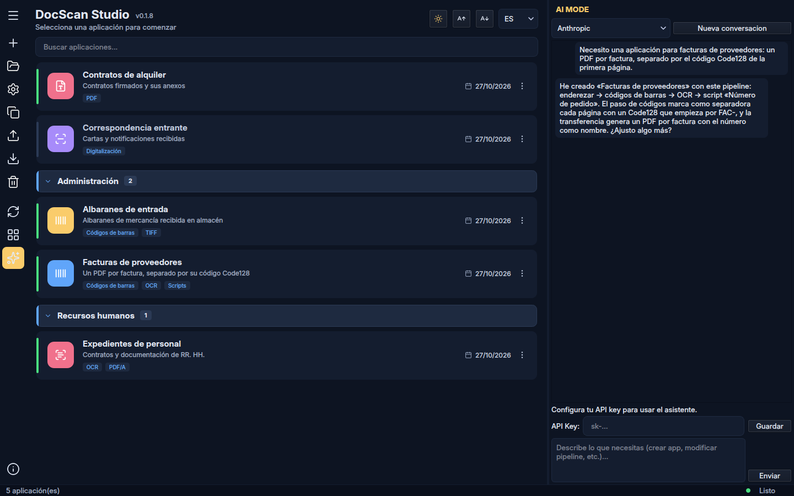

# :material-robot: AI Mode

AI Mode es un asistente conversacional integrado en el Launcher para crear y configurar aplicaciones mediante lenguaje natural.



## Configurar API key

1. Hacer clic en **AI MODE** en la sidebar: el panel se abre a la derecha del
   Launcher
2. Elegir el proveedor en el desplegable: **Anthropic** u **OpenAI**
3. Escribir la clave en **API Key** y pulsar **Guardar**
4. Las claves se cifran con **Fernet** (AES-128-CBC + HMAC-SHA256)

!!! security "Seguridad"
    Las API keys se almacenan cifradas en `secrets.enc`, en la carpeta de
    configuración (`~/.config/docscan/` en Linux, `%LOCALAPPDATA%\docscan\` en
    Windows), y nunca en texto plano.

## Capacidades

- :material-plus-circle: Crear aplicaciones describiendo el caso de uso
- :material-pencil: Modificar la configuración de apps existentes (pipeline,
  campos, transferencia…)
- :material-content-copy: Duplicar aplicaciones
- :material-delete: Eliminar aplicaciones
- :material-code-tags: Escribir el código de los eventos de una aplicación
- :material-magnify: Consultar las aplicaciones existentes y su configuración

## Revisar los cambios

El asistente no cambia nada por su cuenta. Cada cambio que propone aparece en
el panel como una tarjeta con su resumen (y el código, si lo hay) y los botones
**Aceptar** y **Rechazar**. Solo al aceptar se aplica. Para eliminar una
aplicación, los botones son **Confirmar eliminacion** y **Cancelar**.

**Nueva conversacion** empieza de cero.

## Ejemplo

```
👤 Necesito una app para digitalizar albaranes. Cada albarán tiene
   un barcode Code128 con el número de pedido.

🤖 He creado "Albaranes" con:
   - Pipeline: AutoDeskew → Barcode Motor 2 con separador de documento (Code128)
   - Campo de lote: "numero_pedido"
   - Transferencia: un PDF por documento, /salida/{separator}.pdf
```
