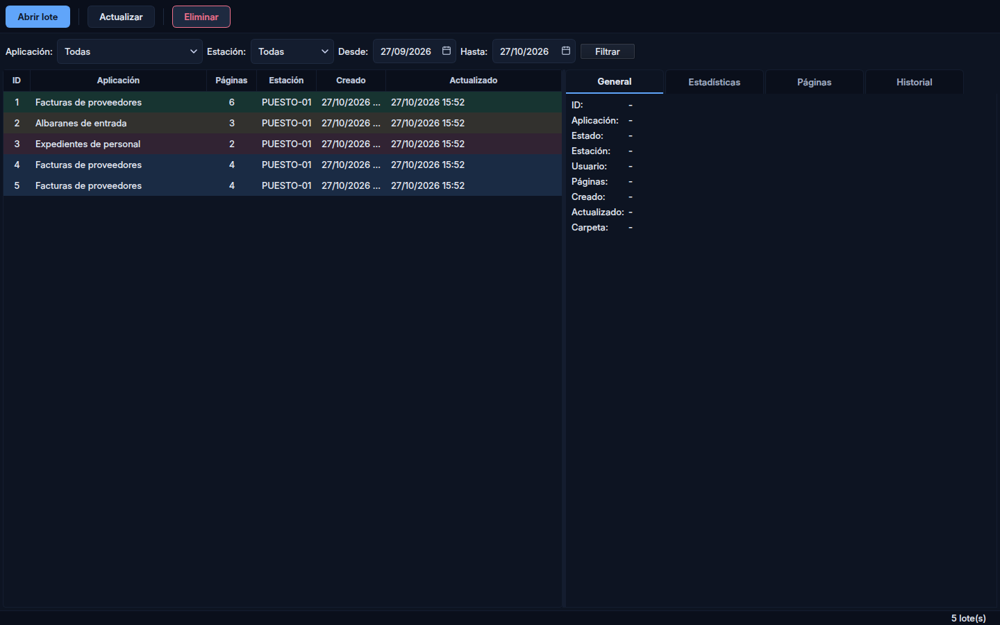

# :material-folder-multiple: Gestión de lotes

El Gestor de Lotes permite consultar el histórico completo de lotes procesados.

## Filtros

| Filtro | Descripción |
|--------|-------------|
| Aplicación | Filtrar por aplicación específica (*Todas* por defecto) |
| Estación | Filtrar por ordenador/hostname (*Todas* por defecto) |
| Desde / Hasta | Período de búsqueda. Por defecto, los últimos 30 días |

Los filtros se aplican al pulsar **Filtrar**.

## Estados del lote

El estado se ve en el color de la fila y en la pestaña General del detalle.

| Estado | Descripción |
|--------|-------------|
| Creado | Lote nuevo, sin páginas leídas todavía |
| Leído | Páginas capturadas o importadas y pasadas por el pipeline (en el worker, pendientes del pipeline) |
| Verificado | Cerrado en el Workbench con **Cerrar lote**, sin transferir |
| Listo exportar | Pipeline terminado en el worker, pendiente de transferir |
| Exportado | Transferido al destino |
| Error lectura | En el worker, no se importó ninguna imagen o el pipeline falló en todas las páginas |
| Error export. | Falló la transferencia o la validación previa en el worker |

## Detalle del lote

Al seleccionar un lote, el panel derecho muestra cuatro pestañas:

- **General**: ID, aplicación, estado, estación, usuario, páginas, fechas y
  carpeta.
- **Estadísticas**: páginas totales, a revisión, excluidas, en blanco y con
  errores, y las estadísticas del pipeline.
- **Páginas**: una fila por página con revisión, excluida, blanco, OCR y
  errores.
- **Historial**: las operaciones del lote con su fecha y el cambio de estado.

## Acciones

- **Abrir lote**: Reabre un lote anterior en el Workbench
- **Eliminar**: Borra el lote y sus imágenes, tras confirmar (irreversible)
- **Actualizar**: Refresca la lista (también se actualiza automáticamente cada 20s)

## Reprocesar

Un lote reabierto permite:

- Reprocesar una página individual con **Ctrl+P**
- Las páginas pendientes se procesan automáticamente al reabrir
