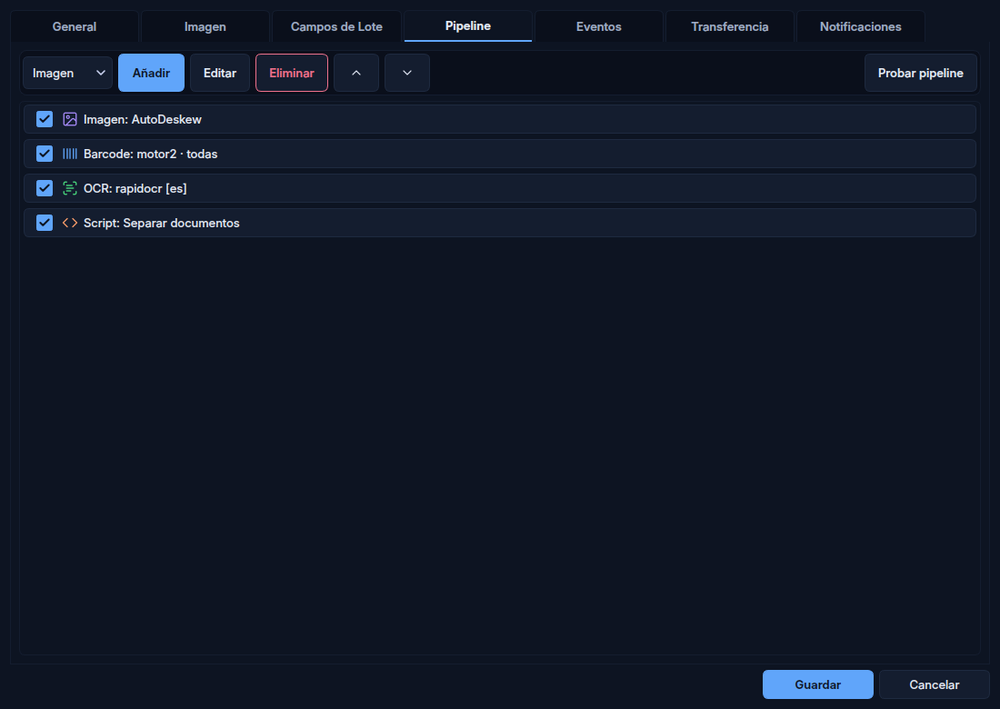
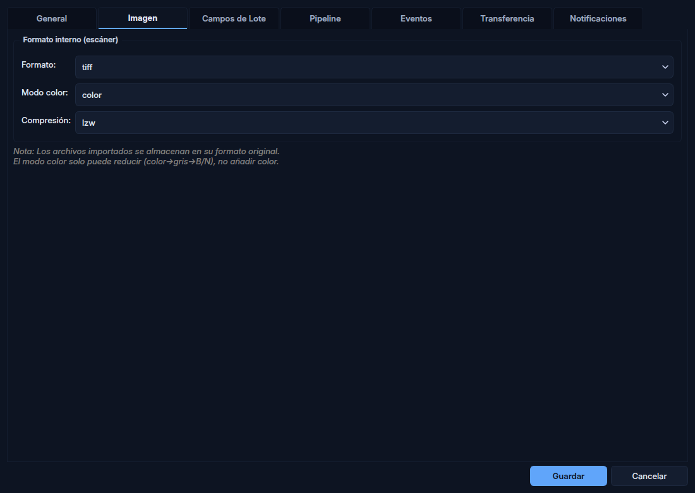
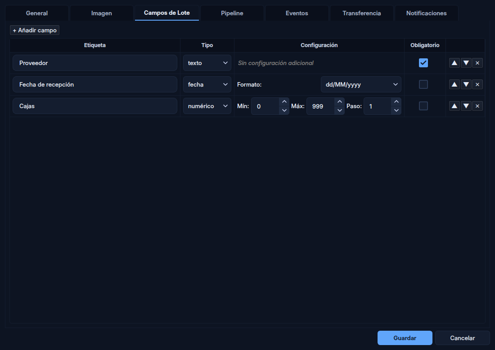
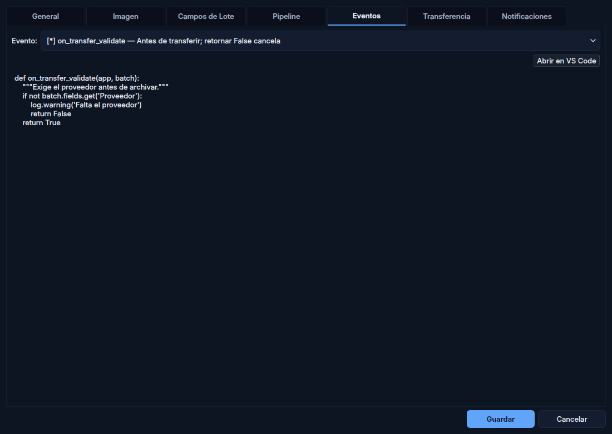
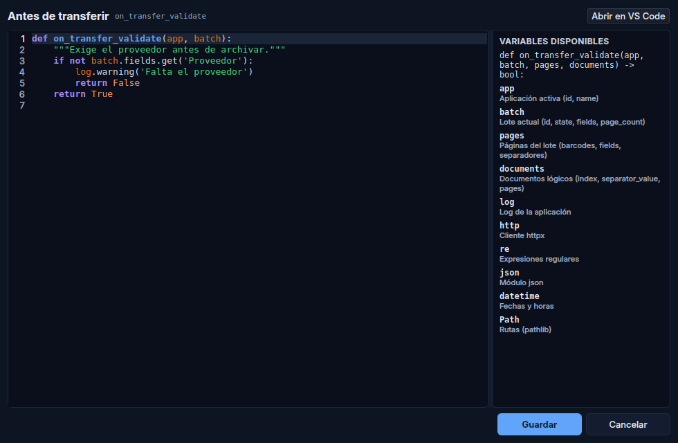

# :gear: Configurador

El configurador permite ajustar cada aspecto de una aplicación a través de **7 pestañas**: General, Imagen, Campos de lote, Pipeline, Eventos,
Transferencia y Notificaciones.

## Pestaña General

Configuración básica de la aplicación.

| Opción | Descripción |
|--------|-------------|
| Nombre | Nombre visible en el Launcher |
| Descripción | Texto descriptivo del propósito |
| Activa | Las inactivas se ven con el indicador gris en el Launcher |
| Backend escáner | SANE (Linux) o TWAIN/WIA (Windows), según el sistema. Un backend de otra plataforma (una App preparada para Windows abierta en Linux) se conserva al guardar |
| Mostrar el diálogo del escáner al capturar | Valor por defecto de la casilla de ⚙ en los equipos donde el operador no la ha cambiado |
| Color del icono | Color de la tarjeta en el Launcher. «Automático» lo saca del nombre, como FlexibarNET 10 |
| Transferir automáticamente | Transferir al completar el pipeline |
| Cerrar tras transferir | Cierra el Workbench después de transferir |
| Barcode manual | Expresión regex o valor fijo para los códigos añadidos a mano, y la casilla que oculta «+ Añadir» |
| Detección de páginas en blanco | Excluir páginas en blanco automáticamente |
| Pestañas del Workbench | Qué paneles y pestañas ve el operador y en qué orden |

## Pestaña Imagen

Define el formato de captura: formato de fichero, modo de color y compresión.

## Pestaña Campos de lote

Campos dinámicos que el operador rellena en el Workbench. Como en FlexibarNET 10,
la pestaña es un **maestro-detalle**: a la izquierda la lista de campos (nombre y,
debajo, tipo y «· obligatorio»), con **+ Añadir campo**, **✕ Eliminar** y las
flechas para reordenar; a la derecha, el editor del campo seleccionado. Los
cambios se aplican al momento; se guardan con el botón **Guardar** del
configurador.

| Propiedad | Para qué sirve |
|-----------|----------------|
| Nombre del campo | Etiqueta en el Workbench y clave del valor en scripts (`batch.fields["Nombre"]`) y en la transferencia |
| Tipo | Control del Workbench y configuración propia (tabla de abajo) |
| Obligatorio | Un campo obligatorio vacío bloquea la transferencia |
| Valor por defecto | Se propone al abrir un **lote nuevo**; el operador puede cambiarlo. Vacío = sin valor (en las fechas, hoy) |
| Descripción | Nota interna para quien configura; el operador no la ve |

| Tipo | Widget | Configuración |
|------|--------|---------------|
| Texto | Campo libre | — |
| Fecha | Calendario | Formato de fecha |
| Lista | Desplegable | Valores separados por coma |
| Numérico | Spinner | Mínimo, máximo, paso |

Al guardar se conservan las claves del campo que el editor no muestra (por
ejemplo, las que añada una versión posterior o un script de alta de Apps).

## Pestaña Pipeline

Cada fila de la lista es un paso, como en FlexibarNET 10:

- una **casilla** que lo activa o desactiva (un paso desactivado se ve atenuado y
  no se ejecuta);
- el **icono de su tipo**, cada uno con su color: imagen, barcode, OCR y script;
- su nombre y lo esencial de su configuración.

Doble clic para editar un paso. Para cambiar el orden, arrástralo o usa los botones
de subir y bajar.

El diálogo del paso **Barcode** sigue el orden del editor de FlexibarNET 10.
Primero, la **configuración del lector** por secciones:

| Sección | Qué contiene |
|---------|--------------|
| Simbologías | Una casilla por simbología, agrupadas en *1D lineal*, *EAN/UPC* y *2D*. Ninguna marcada = todas las que lee el motor |
| Lectura | Motor (`motor1` pyzbar, `motor2` zxing-cpp), orientaciones (horizontal, vertical, 45/135) y confianza mínima |
| Imagen | Región de escaneo en píxeles (X, Y, ancho, alto); todo a 0 = página completa |
| Filtrado | Expresión regular tras la lectura, *Incluir simbología en regex* y, debajo, la leyenda de números de simbología (Code39 = 01, Code128 = 02, QR = 22…) |
| Avanzado | La configuración del paso en JSON, tal como se guarda; se actualiza con el formulario |

Después, el **separador de documento** en dos bloques:

- **Detección automática**: casilla *Detectar separador automáticamente* y la
  condición (*Por simbología*, *Por expresión regular* o *Por valor fijo*).
  Solo se ve el campo de la condición elegida; la de expresión regular lleva
  *Incluir simbología en la expresión* y la misma leyenda de números.
- **Marca manual**: la regex que valida lo que teclea el operador al marcar un
  separador a mano (Ctrl+D) y el valor que se le propone. Es independiente de
  la detección automática.

Ver [Separador de documento](pipeline.md#separador-de-documento).

Ver [Pipeline](pipeline.md) para la documentación completa.

## Pestaña Eventos

Como en FlexibarNET 10, a la izquierda está la **lista de eventos del ciclo de
vida**. Cada fila lleva un punto de estado, el nombre legible («Antes de
transferir») y el nombre canónico en monoespaciada (`on_transfer_validate`):

| Estado | Punto | Significado |
|--------|-------|-------------|
| Sin script | Vacío | El evento no tiene código |
| **ACTIVO** | Verde | Tiene código y se ejecuta |
| **PAUSADO** | Amarillo | Tiene código pero la casilla *Activado* está desmarcada: no se ejecuta |

A la derecha, el detalle del evento seleccionado: su descripción, la casilla
**Activado**, el resumen del código (solo lectura) y el botón **Editar
script…**. La pestaña se abre en el primer evento con código.

**Editar script…** (o doble clic en el resumen) abre el editor del evento con el
panel **Variables disponibles**: la firma del evento y lo que recibe el script
(`app`, `batch`, `pages`…, más `log`, `http`, `re`, `json`, `datetime` y
`Path`). *Abrir en VS Code* aparece si está instalado. **Guardar** devuelve el
código a la pestaña; **Cancelar** lo descarta.

Un evento **pausado** conserva el código pero no corre en ningún sitio: ni en el
Workbench, ni en el worker desatendido, ni en la validación o la transferencia
avanzada. En `events_json` se guarda como `{"script": "…", "enabled": false}`;
un evento activado se sigue guardando como texto, igual que antes.

Ver [Scripting](scripting.md) para los eventos del ciclo de vida.

## Editor de scripts

Todos los scripts (eventos, pasos Script, script de nombre de fichero y las
vistas previas de los asistentes) se editan con el mismo editor: fuente
monoespaciada, colores de Python según el tema, números de línea y resaltado
de la línea actual. **Tab** inserta cuatro espacios (o sangra la selección),
**Mayús+Tab** quita un nivel e **Intro** mantiene la sangría y añade un nivel
después de `:`.

## Pestaña Transferencia

Ver [Transferencia](transfer.md) para las opciones de exportación. Además del
destino y el patrón:

- **Modo**: `folder`, `pdf`, `pdfa`, `tiff` (multipágina) o `csv`.
- **Nombre por**: *Patrón* o *Script*. Con *Script* aparece un editor con la
  plantilla de `file_name(page, document, batch, app)`; la aplicación **no se
  guarda** si el script no compila.
- Grupo **Documentos**: agrupación (un fichero por lote o por documento, en
  los modos multipágina) y si la página separadora se incluye o se descarta.

## Pestaña Notificaciones

Un webhook (URL, método, timeout y cabeceras) al que el worker desatendido avisa
cuando termina una transferencia o cuando falla.
