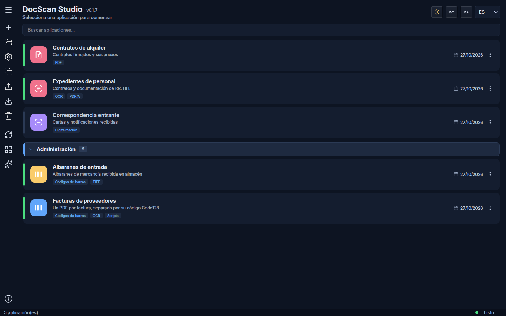
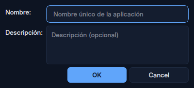

# :house: Launcher

El Launcher es la ventana principal de DocScan Studio. Desde aquí se gestionan todas las **aplicaciones** (perfiles de procesamiento).

## Tarjetas de aplicación

Cada aplicación es una tarjeta, como en FlexibarNET 10:

- **Indicador** a la izquierda: verde si la aplicación está activa, gris si no.
- **Icono sobre un color**.
  - El icono se deduce de la configuración, en este orden: lee códigos de barras →
    OCR → salida PDF → escáner elegido en el Workbench → documento.
  - El color sale del nombre: el mismo nombre da siempre el mismo color, también en
    FlexibarNET 10. Se puede fijar otro en **Configurador → General → Color del
    icono**.
- **Nombre, descripción y hasta tres etiquetas**: «Códigos de barras», «OCR»,
  «Scripts» y el formato de salida (`PDF`, `PDF/A`, `TIFF`, `CSV`…). Una aplicación
  sin nada de eso muestra «Digitalización».
- **Fecha** de la última modificación.
- **⋮** abre el menú de la aplicación: Abrir, Configurar, Clonar, Exportar y
  Eliminar. El botón derecho sobre la tarjeta abre el mismo menú.

La barra de estado muestra cuántas aplicaciones hay y, a la derecha, «● Listo».

## Grupos

Las aplicaciones con **grupo** (pestaña General del configurador) aparecen bajo
una cabecera con el nombre del grupo y el número de aplicaciones, igual que en
FlexibarNET 10:

- Las aplicaciones **sin grupo** van primero, sin cabecera. Después, los grupos
  por orden alfabético.
- **Un clic en la cabecera** pliega o despliega el grupo. Cada equipo recuerda
  qué grupos tiene plegados.
- No hay que crear los grupos aparte: un grupo existe mientras alguna aplicación
  lo tenga. Si se vacía el grupo de la última, la cabecera desaparece.
- **La búsqueda** filtra también dentro de los grupos. La cabecera cuenta solo
  las aplicaciones encontradas y desaparece si no queda ninguna. Un grupo
  plegado sigue plegado mientras se busca: despliégalo para ver los resultados.

## Sidebar

La sidebar izquierda proporciona acceso rápido a todas las acciones. Se puede expandir/colapsar haciendo clic en el icono de menú.

| Botón | Acción | Descripción |
|-------|--------|-------------|
| :material-plus: Nueva | Crear aplicación | Diálogo para nombre y descripción |
| :material-folder-open: Abrir | Abrir workbench | Abre la aplicación seleccionada (si está inactiva, avisa y no la abre) |
| :material-cog: Configurar | Editar configuración | Abre el configurador con 7 pestañas |
| :material-content-copy: Clonar | Duplicar | Copia exacta de la aplicación |
| :material-upload: Exportar | Fichero .docscan | Exporta como JSON portable |
| :material-download: Importar | Desde .docscan | Carga aplicación desde fichero (`.docscan` o `.json`) |
| :material-delete: Eliminar | Borrar aplicación | Elimina app y datos (irreversible) |
| :material-refresh: Actualizar | Refrescar lista | Recarga desde la base de datos |
| :material-view-grid: Gestor de Lotes | Histórico | Consultar lotes anteriores |
| :material-robot: AI MODE | Asistente IA | Panel conversacional con IA |
| :material-information: Acerca de | Información | Versión, créditos y **Buscar actualizaciones** |

## Crear una aplicación

1. Clic en **Nueva** en la sidebar
2. Introducir nombre y descripción
3. La aplicación aparece en la lista
4. Seleccionarla y hacer clic en **Configurar** para personalizar el pipeline

## Exportar / Importar

Las aplicaciones se exportan como ficheros `.docscan` (JSON) que incluyen:

- Configuración general: grupo, color del icono, diálogo del escáner, pestañas
  del Workbench y barcode manual
- Configuración de imagen
- Pipeline completo
- Campos de lote
- Eventos y scripts
- Configuración de transferencia
- Notificaciones

!!! warning "No se exportan"
    Las API keys, los lotes ni las imágenes no se incluyen en la exportación.

## Tema, letra e idioma

La barra superior del Launcher permite:

- :material-brightness-6: Alternar entre tema **claro** y **oscuro**
- **A↑ / A↓**: aumentar o reducir el tamaño de letra
- :material-translate: Cambiar idioma en el desplegable: **ES** (español),
  **EN** (inglés) y **CAT** (catalán)

!!! note
    El cambio de idioma requiere reiniciar la aplicación.

## Aviso de actualización

Si hay una versión nueva, aparece un aviso bajo la barra superior con **Ver
novedades**, **Actualizar** e **Ignorar** (ver
[Actualizaciones](getting-started.md#actualizaciones)).
