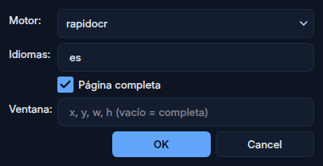
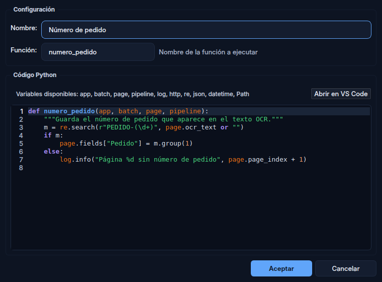

# :material-pipe: Pipeline

El pipeline es el **corazón** de DocScan Studio. Cada página escaneada/importada pasa por una secuencia configurable de pasos.

```
┌──────────┐   ┌──────────┐   ┌──────────┐   ┌──────────┐
│ ImageOp  │──▶│ Barcode  │──▶│   OCR    │──▶│  Script  │
└──────────┘   └──────────┘   └──────────┘   └──────────┘
```

## Tipos de paso

| Tipo | Descripción | Ejemplo |
|------|-------------|---------|
| `image_op` | Operación de imagen | AutoDeskew, Crop, FxGrayscale |
| `barcode` | Lectura de barcodes | Code128 en zona superior |
| `ocr` | Reconocimiento de texto | RapidOCR página completa |
| `script` | Lógica Python | Clasificar por el texto OCR |

## Operaciones de imagen

??? note "24 operaciones disponibles"

    | Operación | Descripción |
    |-----------|-------------|
    | AutoDeskew | Corrección de inclinación |
    | ConvertTo1Bpp | Blanco y negro (1 bit) |
    | Crop | Recorte rectangular |
    | CropWhiteBorders | Recorte de márgenes blancos |
    | CropBlackBorders | Recorte de márgenes negros |
    | Resize | Redimensionar |
    | Rotate | Rotar 90°/180°/270° |
    | RotateAngle | Rotación libre |
    | SetBrightness | Ajustar brillo |
    | SetContrast | Ajustar contraste |
    | RemoveLines | Eliminar líneas |
    | FxDespeckle | Eliminar ruido |
    | FxGrayscale | Escala de grises |
    | FxNegative | Invertir colores |
    | FxDilate | Dilatación |
    | FxErode | Erosión |
    | FxEqualizeIntensity | Ecualización |
    | FloodFill | Relleno |
    | RemoveHolePunch | Quitar perforaciones |
    | SetResolution | Ajustar DPI |
    | SwapColor | Intercambiar colores |
    | KeepChannel | Extraer canal |
    | RemoveChannel | Eliminar canal |
    | ScaleChannel | Escalar un canal por un factor |

### ¿La operación cambia el fichero entregado?

Por defecto **no**. Una operación de imagen prepara la página para los
pasos que vienen detrás (leer barcodes, hacer OCR), pero el fichero que
se archiva y se transfiere conserva el original del escáneo. Así puedes
binarizar o invertir la imagen para leer mejor sin destruir el documento.

Cuando sí quieras que el resultado llegue al documento entregado —lo
habitual en `AutoDeskew`, `CropWhiteBorders`, `Rotate` o
`RemoveHolePunch`— marca en el paso la casilla **«Guardar el resultado en
el fichero de la página»**.

!!! tip "Se guarda ese punto exacto del pipeline"

    La casilla toma una instantánea del resultado **de ese paso**. Un
    paso posterior sin la casilla marcada sigue alimentando al pipeline,
    pero ya no afecta al fichero. El caso típico es enderezar y archivar
    (`AutoDeskew` con la casilla) y después binarizar solo para leer
    (`ConvertTo1Bpp` sin ella): se archiva la página enderezada en color,
    y los barcodes se leen sobre la binarizada.

    Si varios pasos la marcan, gana el último.

## Simbologías de barcode

| Simbología | Motor 1 (pyzbar) | Motor 2 (zxing-cpp) |
|------------|:-:|:-:|
| Code128 | :white_check_mark: | :white_check_mark: |
| Code39 | :white_check_mark: | :white_check_mark: |
| Code93 | :white_check_mark: | :white_check_mark: |
| Codabar | :white_check_mark: | :white_check_mark: |
| EAN-13/8, UPC-A/E | :white_check_mark: | :white_check_mark: |
| ITF (Interleaved 2 of 5) | :white_check_mark: | :white_check_mark: |
| QR Code | :white_check_mark: | :white_check_mark: |
| DataMatrix | :x: | :white_check_mark: |
| PDF417 | :x: | :white_check_mark: |
| Aztec | :x: | :white_check_mark: |
| MaxiCode | :x: | :white_check_mark: |
| MicroQR | :x: | :white_check_mark: |

## Paso Barcode

Lee los códigos de la página (o de una ventana) y los acumula en
`page.barcodes`. Opciones principales:

- **Motor**: `motor1` (pyzbar) o `motor2` (zxing-cpp).
- **Simbologías**: las que se leen; vacío = todas.
- **Regex**: filtro sobre el valor; solo se guardan los códigos que casan.
- **Incluir simbología en regex**: la regex se evalúa sobre **NN + valor**,
  donde NN es el número legacy de la simbología (ver la tabla de abajo). Así
  `^02` acepta solo Code128. Antes se anteponían las dos primeras letras del
  nombre («Co»), con lo que ninguna regex heredada de Flexibar casaba.

Con `motor1` solo se leen las simbologías con ✓ en su columna de la tabla de
arriba. En el diálogo, las que no (DataMatrix, PDF417, Aztec, MaxiCode y MicroQR)
llevan el aviso «Solo la lee el motor 2 (zxing-cpp)». Un paso `motor1` que solo
pide simbologías de esas no encuentra nada.

### Separador de documento

Un **documento** es el tramo de páginas que va de una página separadora a la
siguiente; las anteriores al primer separador forman un documento implícito.
La marca es de la **página** (`page.is_separator`, `page.separator_value`),
no del barcode. Es el modelo de FlexibarNET 10, con las mismas claves de
configuración (`separator_*`).

Con *Detectar separador automáticamente* marcado, el paso marca como separadora la página
en la que algún código cumple la condición, y guarda su valor:

| Condición | Se cumple si… |
|-----------|---------------|
| Expresión regular | La regex encuentra algo en el valor (o en NN + valor con *Incluir simbología en la expresión*) |
| Simbología | La simbología del código es la indicada (sin distinguir mayúsculas) |
| Valor fijo | El valor es exactamente el indicado |

Números legacy de simbología (los mismos que el Flexibar original):

| NN | Simbología | NN | Simbología |
|----|-----------|----|-----------|
| 01 | Code39 | 10 | ITF (Interleaved 2 of 5) |
| 02 | Code128 | 19 | Aztec |
| 03 | UPCA | 20 | DataMatrix |
| 04 | EAN13 / EAN8 | 21 | PDF417 |
| 06 | UPCE | 22 | QR |
| 08 | Code93 | 38 | MicroQRCode |
| 09 | Codabar | 39 | MaxiCode |

Ejemplo: regex `^(02|10)` con *Incluir simbología en la expresión* = toda página con un
Code128 o un ITF es separadora (Apps del Hospital Arnau de Vilanova).

Reglas:

- **La detección manda.** Al reprocesar, el resultado (separadora o no) pisa
  la marca que el operador pusiera a mano. Quien quiera mandar a mano
  desactiva la detección.
- **Varios pasos con detección**: la página es separadora si casa
  **cualquiera**, con el valor del primero que casa.
- **Una regex inválida o que tarda demasiado no casa**: nunca marca un
  separador por error.
- Un **ScriptStep posterior** puede cambiar `page.is_separator` y
  `page.separator_value`.

Para la marca manual en el Workbench (Ctrl+D) el paso define además:

- **Validación del valor (regex)**: valida lo que teclea el operador. No afecta a la
  detección automática. Vacío = sin validación.
- **Valor por defecto**: con el que se pre-rellena el diálogo si la página no
  tiene ningún código.

## Paso OCR

Reconoce el texto de la página y lo deja en `page.ocr_text`, que sustituye al
de un paso OCR anterior.



- **Motor**: `rapidocr` (por defecto), `easyocr` o `tesseract`.
- **Idiomas**: códigos separados por coma (`es, en, fr`).
- **Página completa**: desmarcada, se reconoce solo la **Ventana** (`x, y, w,
  h`).

Si el motor no está instalado, el paso falla y la página queda a revisión, en
lugar de guardar un texto vacío.

## Paso Script

Ejecuta una función Python sobre cada página.



- **Nombre**: el que se ve en la lista del pipeline.
- **Función**: nombre de la función que se ejecuta, con la firma
  `(app, batch, page, pipeline)`.
- **Código Python**: el script, en el editor del Configurador o con **Abrir en
  VS Code** si está instalado.

Si el script no compila, no define la función, lanza una excepción o tarda más
de **30 segundos** (ajustable), el pipeline sigue con los demás pasos: el error
queda en `page.flags.script_errors` y la página, a revisión. Ver
[Scripting](scripting.md).

## Control de flujo

Los scripts pueden controlar la ejecución del pipeline:

```python
def mi_script(app, batch, page, pipeline):
    # Saltar un paso
    pipeline.skip_step("paso_ocr_1")

    # Repetir (máx. 3 veces)
    pipeline.repeat_step("paso_barcode")

    # Abortar (marca para revisión)
    pipeline.abort("Error crítico")

    # Compartir datos entre pasos
    pipeline.set_metadata("tipo_doc", "factura")
```

## Probar pipeline

El botón **Probar pipeline** permite ejecutar todos los pasos sobre una imagen de muestra y ver el resultado paso a paso.


